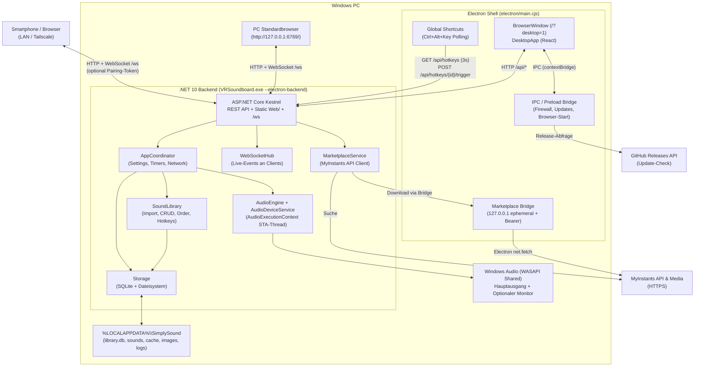
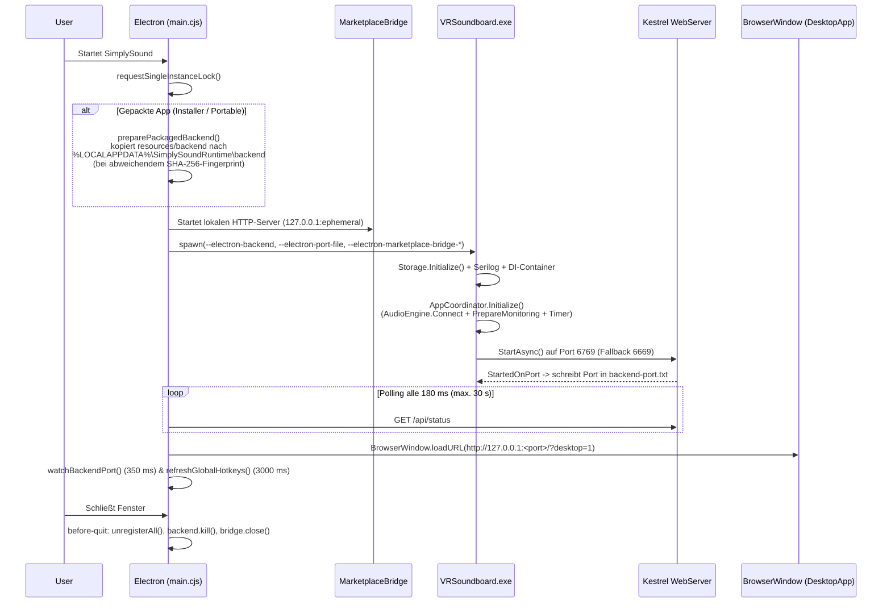

# Architekturübersicht – SimplySound

> **Analysierter Stand:** `v1.1.9` (`c3aaf471b2452c11c37d326703a5e820b6995fa3`)

## 1. Gesamtarchitektur

SimplySound ist eine **hybride Windows-Desktop- und Web-Anwendung**, bestehend aus drei klar getrennten Laufzeitschichten:

1. **Electron Desktop-Shell (`electron/`):** Verpackt die App für Windows (NSIS-Installer und Portable-EXE), startet das .NET-Backend als Kindprozess, verwaltet globale Windows-Hotkeys, Windows-Firewall-Regeln, Update-Prüfungen und eine lokale HTTP-Download-Bridge für MyInstants.
2. **C# / .NET 10 Backend (`VRSoundboard.exe`):** Selbstenthaltener Windows-Dienst mit integriertem **ASP.NET Core Kestrel Webserver** (REST-API + WebSocket + statische Auslieferung der React-App), **NAudio/WASAPI-Audio-Engine** auf eigenem STA-Thread und **SQLite-Datenhaltung**. Enthält zusätzlich noch die historische WPF-Oberfläche (`MainWindow.xaml`), die jedoch im Electron-Betrieb über `--electron-backend` deaktiviert wird.
3. **React 19 + Vite 8 Web-UI (`webui/` → gebaut nach `Web/`):** Eine einzelne SPA-Codebasis, die je nach URL-Parameter zwei unterschiedliche Oberflächen rendert:
   - `/?desktop=1` → **Desktop-Einstellungsfenster** (`webui/src/desktop.jsx`), geladen im Electron-`BrowserWindow`.
   - `/` → **Soundboard-Oberfläche** (`webui/src/main.jsx`), genutzt sowohl auf dem PC (im Standardbrowser über „Open soundboard“) als auch auf Smartphones im lokalen WLAN oder Tailscale-Netz.

> **Wichtige Beobachtung:** Das Electron-Fenster ist bewusst **kein** zweites Soundboard, sondern ein Einstellungs- und Verbindungs-Dashboard (QR-Code, Audio-Routing, Netzwerk, Updates). Das eigentliche Soundboard öffnet sich auf dem PC im Standardbrowser unter `http://127.0.0.1:<port>/` (`electron/soundboard-link.cjs`).

## 2. Verzeichnisstruktur

| Pfad | Zweck |
|---|---|
| `VRSoundboard.csproj`, `global.json`, `NuGet.Config` | .NET-10-Backend-Projektdatei (`net10.0-windows`, `WinExe`, `UseWPF`, `UseWindowsForms`) |
| `App.xaml`, `App.xaml.cs` | C#-Einstiegspunkt, DI-Container (`ServiceCollection`), Headless- vs. WPF-Start |
| `AppCoordinator.cs` | Zentrale Steuerung: Settings, Netzwerk-IP-Ermittlung, Reconnect- & Playback-Timer |
| `AudioExecutionContext.cs` | Dedizierter STA-Thread mit `BlockingCollection<Action>` für alle COM/WASAPI-Aufrufe |
| `AudioServices.cs` | `AudioDeviceService`, `AudioEngine`, `SwitchingWaveProvider`, `AudioResourceCleanup`, `MonitorStreamReadiness` |
| `LowLatencyAudio.cs` | Echtzeit-Audio-Pipeline (`LimitedSampleProvider`, `ChannelMappingSampleProvider`, `GainSampleProvider`, `NativeFormatWaveProvider`) |
| `DeviceNameCache.cs` | 30-Sekunden-Cache für Windows-Audio-Endpunktnamen |
| `Models.cs` | Domänenmodelle (`Sound`, `AppSettings`, `AppSettingsView`, `SoundHotkey`, `DeviceInfo`, `PlaybackState`) |
| `Storage.cs` | SQLite-Persistenz (`database/library.db`) und Legacy-Datenmigration (`Soundboardify` / `VRSoundboard` → `SimplySound`) |
| `SoundLibrary.cs` | Thread-sichere Sound-Verwaltung (Import + WAV-Transkodierung, Update, DeleteMany, Reorder, Hotkey-Cache) |
| `WebServerService.cs` | Kestrel-Webserver, Sicherheits-Middleware, komplette REST-API und `WebSocketHub` |
| `MarketplaceService.cs` | MyInstants-Suche & validierter MP3-Download (direkt oder über Electron-Bridge) |
| `TestTone.cs`, `SteamMicDiagnostic.cs` | Testton-Generator (660 Hz) und Diagnose des Steam-Streaming-Mikrofon-Pfades (997 Hz) |
| `MainWindow.xaml(.cs)`, `SoundEditor.xaml(.cs)` | Historische WPF-Oberfläche (nur aktiv ohne `--electron-backend`) |
| `electron/` | Electron-Hauptprozess (`main.cjs`), Preload (`preload.cjs`), Hilfsmodule, Build-Skripte, Firewall-PS1, Node-Tests |
| `webui/` | React-19/Vite-8-Quellcode für Soundboard (`main.jsx`, `style.css`) und Desktop-Settings (`desktop.jsx`, `desktop.css`) |
| `tests/SimplySound.Tests/` | xUnit-Testprojekt (Audio-Pipeline, Netzwerk/Security, SoundLibrary, Snapshots, Marketplace, WebSocketHub) |
| `site/` | Statische Projekt-Landingpage (Vite), nicht Teil des Windows-App-Pakets |
| `.github/workflows/` | CI/CD: `windows-build.yml` (Tests + Dist-Build) und `early-beta-releases.yml` (Release-Labeling) |

## 3. Anwendungslebenszyklus (Start bis Beenden)

## 4. Komponenten- und Klassenverantwortlichkeiten

### 4.1 C#-Backend
- **`App` (`App.xaml.cs`):** Parst CLI-Argumente (`--electron-backend`, `--electron-port-file`, `--electron-marketplace-bridge-port`, `--electron-marketplace-bridge-token`), richtet Serilog (tägliche Log-Rotation, 14 Tage Retention in `logs/app-.log`) und `Microsoft.Extensions.DependencyInjection` ein und verbindet `AppCoordinator.Changed` direkt mit `WebSocketHub.Broadcast`.
- **`AppCoordinator` (`AppCoordinator.cs`):**
  - Verwaltet `AppSettings` thread-sicher (`_settingsGate`) und liefert günstige Shallow-Copies (`MemberwiseClone`).
  - Ermittelt dynamisch die beste LAN-IPv4-Adresse (bevorzugt Schnittstellen mit IPv4-Gateway, Wi-Fi vor Ethernet, schließt Loopback, Link-Local `169.254.0.0/16` und Tailscale aus) sowie optional die Tailscale-IPv4-Adresse (`100.64.0.0/10`, RFC 6598 CGNAT-Bereich). Ergebnis wird 5 s gecacht und über `NetworkChange`-Events invalidiert.
  - Führt einmalige Einstellungs-Migrationen durch (`LocalMonitorPreferenceVersion`, `OutputHeadroomPreferenceVersion`).
  - Betreibt zwei `System.Threading.Timer`: alle **50 ms** `audio.Tick()` für Wiedergabefortschritt/Ende und alle **5000 ms** `CheckAudio()` für automatisches Wiederverbinden bei Gerätewechsel.
- **`WebServerService` & `WebSocketHub` (`WebServerService.cs`):**
  - Bindet Kestrel auf `ListenAnyIP(port)` (Standard `6769`, Fallback `6669` bei `AddressAlreadyInUse`).
  - Sicherheits-Middleware schützt jeden Request durch:
    1. Dynamisches Body-Limit pro Route (`GetRequestBodyLimit`: 5 MB + 1 MB Overhead für Coverbilder, sonst `MaxUploadBytes` + 1 MB).
    2. **Host-Header-Validierung** (`IsRequestHostAllowed`): verhindert DNS-Rebinding – erlaubt nur `localhost` (auf Loopback) oder exakte IP-Übereinstimmung mit der empfangenden lokalen Schnittstelle.
    3. **Same-Origin-Prüfung** (`IsSameOrigin`): blockiert Cross-Origin-Browser-Requests.
    4. **Netzwerk-Zugriffssteuerung** (`CanAccessFromNetwork`): erlaubt Loopback immer, private RFC-1918-Netze nur bei `LanAccess = true`, Tailscale (`100.64.0.0/10`) nur bei `TailscaleAccess = true`, öffentliches Internet niemals.
    5. **Optionaler Pairing-Schutz** (`IsPairingAuthorized`): für `/api/*` und `/ws` bei Remote-Clients erforderlich, falls `PairingToken` gesetzt ist (`X-Pairing-Token`-Header oder `?token=`-Query). Loopback ist stets autorisiert.
  - **`WebSocketHub`:** Hält aktive Sockets in `ConcurrentDictionary<Guid, ClientConnection>` mit je einem `SemaphoreSlim(1, 1)` als Schreib-Sperre. Bei `position`-Events wird non-blocking (`Wait(0)`) gesendet, sodass langsame Clients keine Rückstaus erzeugen; andere Events haben 1 s Lock- und 2 s Send-Timeout. Bei 0 Clients wird gar nicht erst serialisiert (`if (_clients.IsEmpty) return;`).

### 4.2 REST-API-Endpunkte (`WebServerService.cs`)

| Methode | Pfad | Zweck |
|---|---|---|
| `GET` | `/api/status` | Server-, Audio-, Monitor-, Playback-Status, Client-Anzahl, Wi-Fi- & Tailscale-URLs |
| `GET` | `/api/phone/qr` | Dynamisch generiertes SVG-QR-Code-Bild für die LAN/Wi-Fi-URL (`Cache-Control: no-store`) |
| `GET` | `/api/sounds` | Alle Sounds sortiert nach `SortOrder` inkl. aktuellem `playing`/`progress`-Status |
| `POST` | `/api/sounds` | Multipart-Upload einer Audiodatei (`.mp3`, `.wav`, `.m4a`, `.aac`, `.wma`) |
| `PATCH` | `/api/sounds/{id}` | Metadaten, Lautstärke (`outputGain`), Mode, Hotkey und Start/End-Trim ändern |
| `DELETE` | `/api/sounds/{id}` | Einzelnen Sound inkl. Dateien löschen (stoppt ihn vorher, falls aktiv) |
| `POST` | `/api/sounds/bulk-delete` | Bis zu 200 Sounds atomar löschen |
| `POST` | `/api/sounds/reorder` | Reihenfolge aller Sounds atomar in einer SQLite-Transaktion speichern |
| `GET` / `POST` / `DELETE` | `/api/sounds/{id}/image` | Coverbild abrufen, hochladen (PNG/JPEG/WebP via Magic Bytes, max. 5 MB) oder entfernen |
| `POST` | `/api/sounds/{id}/play` | Sound abspielen (oder bei `toggle` stoppen, falls aktiv) |
| `POST` | `/api/sounds/{id}/stop` | Spezifischen Sound stoppen |
| `POST` | `/api/stop` | Aktive Audiowiedergabe sofort stoppen |
| `GET` | `/api/hotkeys` | Liste aller aktiven Hotkey-Zuordnungen (`id`, `name`, `hotkey`) |
| `POST` | `/api/hotkeys/{id}/trigger` | Auslösung eines Sounds per globalem Hotkey (respektiert `toggle`/`retrigger`) |
| `GET` / `PATCH` | `/api/settings` | Einstellungen abrufen (`AppSettingsView`, ohne `PairingToken`) und aktualisieren |
| `GET` | `/api/audio/devices` | Alle Windows-Render-Endpunkte inkl. MixFormat und Zustand auflisten |
| `POST` | `/api/audio/device` | Haupt-Audioausgang wählen (`null` = Windows-Standard) |
| `POST` | `/api/audio/monitor-device` | Lokales Monitoring-Gerät wählen (`null` = Windows-Standard) |
| `POST` | `/api/audio/test` | 660-Hz-Testton (0,2 s) abspielen |
| `POST` | `/api/audio/diagnose` | Steam-Streaming-Mic-Diagnose ausführen (**nur Loopback erlaubt**) |
| `GET` | `/api/marketplace/search?q=` | MyInstants-Katalog abfragen (oder `recent` bei leerem `q`) |
| `POST` | `/api/marketplace/{id}/install` | MyInstants-Sound über Allowlist + Magic-Byte-Prüfung herunterladen und importieren |
| `WS` | `/ws` | Echtzeit-Event-Stream (`position`, `sound-started`, `sound-stopped`, `sound-added`, `sound-changed`, `sound-deleted`, `sounds-deleted`, `order-changed`, `settings-changed`, `audio-device`) |

### 4.3 Interprozesskommunikation (Electron ↔ Backend ↔ Renderer)
1. **Electron ↔ Renderer (`preload.cjs`):** Strikte `contextIsolation: true`, `sandbox: true`, `nodeIntegration: false`. Exponiert ausschließlich `window.SimplySoundDesktop` mit 9 IPC-Methoden und 1 Event-Listener (`onSoundboardLaunchError`). Alle `ipcMain.handle`-Handler prüfen `event.sender === mainWindow.webContents`.
2. **Electron ↔ Backend:**
   - Startparameter + temporäre Portdatei (`%APPDATA%\SimplySound\backend-port.txt`, alle 350 ms überwacht bei Portwechsel).
   - Lokale HTTP-Aufrufe gegen `http://127.0.0.1:<port>/api/*` (Healthcheck, Hotkey-Polling alle 3 s, Hotkey-Trigger).
   - Rückkanal Backend → Electron: `MarketplaceService` ruft die lokale `marketplace-bridge` auf `http://127.0.0.1:<ephemeral>/download` mit `Authorization: Bearer <64-hex-token>` auf, um MP3s über Chromiums `net.fetch` (mit `Referer: https://www.myinstants.com/`) zu laden.

## 5. Benutzeroberflächen im Vergleich

| Oberfläche | Dateien | Aktiv wann? | Hauptaufgaben |
|---|---|---|---|
| **Electron Desktop-UI** | `webui/src/desktop.jsx`, `desktop.css` | Standard bei SimplySound-Start (`/?desktop=1`) | Setup-Wizard, QR-Code & Links (WLAN/Tailscale), Button „Open soundboard“, Audio-/Monitor-Gerätewahl, Master-Lautstärke, Virtual-Mic-Headroom, Pairing, Firewall, GitHub-Update-Check |
| **Web-Soundboard** | `webui/src/main.jsx`, `style.css` | Im PC-Browser (`127.0.0.1:<port>/`) & auf dem Handy | Kachel-Grid mit Artwork, Abspielen/Stoppen, Inline-Lautstärke pro Sound, Sound-Editor (Name, Titel, Cover, Hotkey, Toggle/Retrigger, Trim Start/Ende), Drag-and-drop-Sortierung, Mehrfachauswahl/Löschen, Upload, MyInstants-Marketplace |
| **Legacy WPF-UI** | `MainWindow.xaml(.cs)`, `SoundEditor.xaml(.cs)` | Nur bei direktem Start von `VRSoundboard.exe` ohne `--electron-backend` | Ältere Desktop-Verwaltung mit Tabs (Dashboard, Sounds, Audio, Web dashboard, Settings, Diagnostics/Logs) inkl. Tray-Icon, Autostart-Registry-Schalter und Theme-Wahl |

## 6. Datenhaltung, Portabilität und Speicherorte

**Zentrale Erkenntnis zur Portable-Version:**  
Obwohl `electron-builder` das Ziel `portable` (`SimplySound-1.1.9-Windows.exe`) erzeugt, verhält sich die Anwendung **nur bei der Installation portabel (kein Setup nötig), nicht bei der Datenhaltung**:

| Datenart | Tatsächlicher Speicherort (auch bei Portable!) | Quelle im Code |
|---|---|---|
| Soundbibliothek (SQLite `database/library.db`), Original-Audios (`sounds/`), WAV-Cache (`cache/`), Coverbilder (`images/`), Logs (`logs/`) | `%LOCALAPPDATA%\SimplySound\` | `Storage.cs:16-17` |
| Entpacktes .NET-10-Backend (`VRSoundboard.exe`, DLLs, `Web/`) | `%LOCALAPPDATA%\SimplySoundRuntime\backend\` | `electron/main.cjs:55-56` |
| Electron-Profil, `setup-state.json`, `backend-port.txt`, Chromium-`localStorage` (`soundboard.visibleCount`) | `%APPDATA%\SimplySound\` | `electron/main.cjs:18-24` |
| Windows-Registry (Autostart `HKCU\...\Run\VRSoundboard`) | Nur in der ungenutzten WPF-UI (`MainWindow.xaml.cs:201-202`); Electron schreibt **keine** Registry-Einträge | `MainWindow.xaml.cs:196-205` |
| Windows-Firewall-Regel (`SimplySound Web UI`) | Optional per Klick/UAC; verweist auf `%LOCALAPPDATA%\SimplySoundRuntime\backend\VRSoundboard.exe` | `electron/firewall-setup.ps1` |

**Auswirkungen beim Verschieben / PC-Wechsel:**
- Das Verschieben der `SimplySound-1.1.9-Windows.exe` auf **demselben PC** funktioniert problemlos, da alle Daten zentral in `%LOCALAPPDATA%` / `%APPDATA%` liegen.
- Beim Kopieren der EXE auf einen **anderen Windows-PC** werden **weder Sounds noch Einstellungen mitgenommen** – hierfür müsste zusätzlich `%LOCALAPPDATA%\SimplySound` (mindestens `database/`, `sounds/`, `images/`) mitkopiert werden. (`cache/` kann nicht automatisch regeneriert werden – siehe `CODE_REVIEW.md`, daher aktuell ebenfalls mitkopieren!)
- **Wichtig für künftige echte Portabilität:** `Storage` akzeptiert bereits `string? localAppDataPath = null` im Konstruktor (`Storage.cs:14`) – ein optionaler Portable-Datenmodus (z. B. wenn neben der EXE ein `data/`-Ordner oder eine Marker-Datei `portable.txt` liegt, gesteuert über `PORTABLE_EXECUTABLE_DIR` von `electron-builder` und ein CLI-Argument `--data-dir=...`) lässt sich später sehr sauber ergänzen!
