# Audioarchitektur & Soundbibliothek – SimplySound

> **Analysierter Stand:** `v1.1.9` (`c3aaf471b2452c11c37d326703a5e820b6995fa3`)  
> **Relevante Quelldateien:** `AudioExecutionContext.cs`, `AudioServices.cs`, `LowLatencyAudio.cs`, `SoundLibrary.cs`, `Storage.cs`, `Models.cs`, `DeviceNameCache.cs`, `TestTone.cs`, `SteamMicDiagnostic.cs`

## 1. Audio-Engine und Signalpfad

### 1.1 Verwendete Bibliothek und Treibermodell
- **Bibliothek:** `NAudio 2.2.1` (`NAudio.CoreAudioApi`, `NAudio.Wave`, `NAudio.Wave.SampleProviders`)
- **Ausgabe-API:** Windows **WASAPI Shared Mode** (`new WasapiOut(device, AudioClientShareMode.Shared, useEventSync: false, latency: 10)` in `AudioServices.cs:192, 361`).
- **Thread-Modell (`AudioExecutionContext.cs`):** Alle `MMDeviceEnumerator`-, `MMDevice`- und `WasapiOut`-COM-Objekte werden strikt auf einem einzigen Hintergrund-**STA-Thread** (`"VRSoundboard audio"`) über eine `BlockingCollection<Action>` serialisiert. Dadurch gibt es keine COM-Apartment-Fehler und eine deterministische Befehlsreihenfolge zwischen Web-API, Hotkeys und Reconnect-Timer.

### 1.2 Signalfluss pro Wiedergabe (`LowLatencyAudio.cs`)

```mermaid
flowchart LR
    File["Cached 16-bit WAV\n(cache/<id>.wav)"] --> Reader["AudioFileReader\n(StartSeconds Seek)"]
    Reader --> Limit["LimitedSampleProvider\n(EndSeconds - StartSeconds)"]
    Limit --> Resample["WdlResamplingSampleProvider\n(nur bei SampleRate-Abweichung)"]
    Resample --> Chan["ChannelMappingSampleProvider\n(Mono/Stereo/3.0–7.1 Downmix\nohne LFE + Soft-Limiter)"]
    Chan --> Gain["GainSampleProvider\n(5 ms Anti-Click-Rampe)"]
    Gain --> Native["NativeFormatWaveProvider\n(32f / 16-, 24-, 32-bit PCM\nmit ArrayPool<float>)"]
    Native --> Switch["SwitchingWaveProvider\n(atomarer Stream-Wechsel\n+ Async-Dispose auf ThreadPool)"]
    Switch --> Wasapi["WasapiOut (Shared, 10 ms)\nEndpunkt-MixFormat"]
```

### 1.3 Technische Details der Verarbeitung
- **Kein Leerlauf-Abbruch / Lückenloses Retriggern:** Die `WasapiOut`-Instanz läuft nach `Connect()` permanent durch. Wenn kein Sound spielt, liefert `SwitchingWaveProvider.Read()` Stille (`Array.Clear`). Beim Abspielen oder Retriggern tauscht `SwitchingWaveProvider.Replace()` den aktiven Stream atomar gegen den neuen aus, ohne den WASAPI-Stream zu stoppen – das vermeidet Startverzögerungen und Knackser.
- **Zero-Allocation im Render-Callback:** `ChannelMappingSampleProvider` und `NativeFormatWaveProvider` leihen ihre Arbeits-Puffer aus `ArrayPool<float>.Shared` (vorallokiert auf 20 ms Frames). Unit-Tests (`AudioPipelineTests.cs:300-335`) verifizieren explizit 0 Byte Allokation im eingeschwungenen Render-Pfad.
- **Auslagerung von Dateischließungen (`SwitchingWaveProvider.Read`):** Erreicht ein Sound sein Ende, wird der abgeschlossene `AudioFileReader` sofort ausgehängt und über `ThreadPool.QueueUserWorkItem` außerhalb des WASAPI-Callbacks geschlossen/freigegeben (`AudioServices.cs:524-530`).
- **Klickfreie Lautstärkeänderungen (`GainSampleProvider`):** Lautstärkeänderungen (Master, Sound-Pegel, Mic-Gain) werden über eine lineare Rampe von 5 ms (`SampleRate / 200` Frames) geglättet (`LowLatencyAudio.cs:40, 52-77`).
- **Mehrkanal-Downmix (`ChannelMappingSampleProvider`):** Unterstützt Mono↔Stereo sowie 3.0, Quad (4.0), 5.0, 5.1, 6.1 und 7.1 auf Stereo. Der LFE-Kanal (Subwoofer) wird bewusst ausgelassen; Spitzen über `0.85` werden mit einem weichen `tanh`-Limiter auf max. `0.98` begrenzt (`LowLatencyAudio.cs:138-197`).
- **Gleichzeitige Wiedergabe (Polyphonie):** Aktuell **nicht unterstützt** – laut `PRODUCT.md:7` und `AudioServices.cs:161, 248-254` gilt bewusst „single active sound“ (ein neuer Sound ersetzt den vorherigen).
- **Wiederholen (Looping) & Fade-in/out:** Aktuell **nicht vorhanden**. Es existieren die Modi `toggle` (erneutes Tippen stoppt) und `retrigger` (erneutes Tippen startet von vorn).

### 1.4 Audio-Routing, Lautstärkekette und Monitoring
- **Hauptausgang (`EndpointId`):** Standardmäßig `null` (= Windows-Standard-Wiedergabegerät `Role.Console`). Nutzer können jedes aktive Render-Gerät wählen (auch virtuelle Audiogeräte wie VB-Cable oder Steam Streaming Microphone). Windows-Systemstandards werden niemals verändert.
- **Lokales Monitoring (`MonitorLocally`, `MonitorEndpointId`):** Ist standardmäßig aktiv (`true`, Migration in `AppCoordinator.cs:109-114`). Wenn das Monitor-Gerät vom Hauptausgang abweicht, wird ein zweiter `WasapiOut` + `SwitchingWaveProvider` vorab bereitgehalten (`PrepareMonitoring`) und parallel mit einem zweiten `AudioFileReader` gefüttert. Sind Haupt- und Monitor-Gerät identisch, wird doppelte Wiedergabe automatisch verhindert (`AudioServices.cs:348-354`).
- **Lautstärkeberechnung:**
  - **Hauptausgang:** `sound.OutputGain * settings.MasterVolume * (settings.UseVirtualMicHeadroom ? Clamp(settings.MicOutputGain, 0..0.25) : 1.0)`
  - **Monitor-Ausgang:** `sound.OutputGain * settings.MasterVolume` (bleibt vom Virtual-Mic-Headroom unberührt)
- **Verhalten bei Gerätewechsel:** Alle 5 Sekunden prüft `AppCoordinator.CheckAudio()` über `AudioDeviceService.GetReconnectState()`, ob der gewählte Endpunkt noch `Active` ist bzw. ob sich das Windows-Standardgerät geändert hat (wenn `EndpointId == null`), und verbindet bei Bedarf automatisch neu. Zudem reagiert `WasapiOut.PlaybackStopped` bei Fehlern (`args.Exception != null`) sofort mit einem Reconnect.

## 2. Soundbibliothek (`SoundLibrary.cs` & `Storage.cs`)

### 2.1 Speicherung und Format
- **Keine fest eingebetteten Sounds:** Alle Sounds werden dynamisch zur Laufzeit importiert.
- **Speicherort:** `%LOCALAPPDATA%\SimplySound\`
  - `database/library.db` – SQLite-Datenbank mit zwei Tabellen:
    - `sounds(id TEXT PRIMARY KEY, sort_order INTEGER NOT NULL, json TEXT NOT NULL)`
    - `settings(key TEXT PRIMARY KEY, json TEXT NOT NULL)`
  - `sounds/<guid>.<ext>` – unveränderte Original-Audiodatei
  - `cache/<guid>.wav` – beim Import dekodierte 16-Bit-PCM-WAV-Datei (für schnellen, formatunabhängigen Zugriff zur Laufzeit)
  - `images/<guid>-<random>.<png|jpg|webp>` – optionales benutzerdefiniertes Coverbild
  - `logs/app-YYYYMMDD.log` – Serilog-Tageslogs (14 Tage Aufbewahrung)

### 2.2 Import-Workflow und unterstützte Formate
- **Unterstützte Audioformate (`SoundLibrary.cs:32`):** `.mp3`, `.wav`, `.m4a`, `.aac`, `.wma` (dekodiert über NAudio `AudioFileReader` / Windows Media Foundation).
- **Grenzen:** Dauer muss `> 0` und `<= 3600` Sekunden (1 Stunde) sein; maximale Dateigröße konfigurierbar `1–200 MB` (Standard: `30 MB`).
- **Import-Ablauf (`SoundLibrary.ImportAsync`):**
  1. Original-Stream nach `sounds/<id>.<ext>` schreiben.
  2. Im Hintergrund-Thread mit `AudioFileReader` dekodieren, Dauer prüfen und als 16-Bit-WAV nach `cache/<id>.wav` schreiben (`WaveFileWriter.CreateWaveFile16`).
  3. Steuerzeichen aus dem Dateinamen entfernen, Länge auf max. 100 Zeichen kürzen.
  4. In SQLite speichern und im In-Memory-Cache `_sounds` aufnehmen; Event `sound-added` über WebSocket verteilen.
  5. Bei Fehlern werden beide Dateien sofort wieder gelöscht (`SoundLibrary.cs:53`).

### 2.3 Gespeicherte Sound-Eigenschaften (`Models.cs`)
Pro Sound werden in JSON (in `library.db`) gespeichert:
- `Id`, `Name`, `ButtonLabel` (optionaler alternativer Button-Text), `SortOrder`, `CreatedUtc`
- `SourceFilename`, `StoredFilename` (`<id>.wav`), `SourceProvider`, `SourceUrl` (z. B. MyInstants)
- `OutputGain` (0.0–1.0, Standard `0.75`), `Volume` (Legacy-Feld)
- `StartSeconds` (Standard `0`), `EndSeconds` (`null` = volle Länge), `SourceDurationSeconds`
- `Mode` (`"toggle"` oder `"retrigger"`)
- `Hotkey` (Format `Control+Alt+<A-Z|0-9|F1-F12>`, Eindeutigkeit in `SoundLibrary.Update` erzwungen)
- `ImageFilename` (Coverbild; Standard-Fallback in UI ist `/assets/logo.png`), `Icon` (Emoji-Feld aus der Legacy-WPF-UI, in der Web-UI aktuell nicht genutzt)
- **Kategorien / Favoriten / Tags:** Im aktuellen Datenmodell **nicht vorhanden** – alle Sounds liegen in einer flachen, sortierbaren Liste.

## 3. Hinzufügen deiner drei persönlichen Sounds (Phase 3)

Für **Der Zonk**, **Blue Oyster Bar** (El Bimbo) und **Edward Simoni – Panflöten-Intro** sind **keinerlei Änderungen am Quellcode** notwendig:

1. SimplySound 1.1.9 Portable starten und auf **„Open soundboard“** klicken (öffnet `http://127.0.0.1:6769/`).
2. Oben rechts auf **`+`** → **„Upload locally“** klicken und die lokalen Audiodateien (`.mp3`, `.wav`, `.m4a`, `.aac` oder `.wma`) auswählen (Mehrfachauswahl möglich).
3. Über das Drei-Punkte-Menü (`...`) jeder Kachel konfigurieren:
   - **Name / Button title:** z. B. `Der Zonk`, `Blue Oyster Bar`, `Edward Simoni – Panflöten-Intro`
   - **Coverbild (optional):** PNG, JPEG oder WebP (max. 5 MB)
   - **Keyboard shortcut (optional):** z. B. `Ctrl + Alt + 1/2/3`
   - **Playback options → Start / End (seconds):** Besonders praktisch für *Blue Oyster Bar* und *Edward Simoni*, falls du ganze Musikdateien besitzt und nur das charakteristische Intro bzw. den passenden Ausschnitt abspielen möchtest (nicht-destruktives Trimmen!).
   - **Output level & Behavior:** Individuelle Lautstärke einstellen; für kurze Effekte wie *Der Zonk* empfiehlt sich `Retrigger` oder `Toggle`, für längere Musikstücke wie *Blue Oyster Bar* unbedingt **`Toggle`** (damit ein zweiter Klick die Musik sofort stoppt!).

## 4. Realistische Audio-Erweiterungen auf Basis der bestehenden Architektur

| Funktion | Machbarkeit | Architekturelle Einordnung |
|---|---|---|
| **Globaler „Stop All“-Button & Stop-Hotkey** | Sehr leicht | `POST /api/stop` existiert bereits im Backend! Nur UI-Button in `main.jsx` + optionaler globaler Hotkey in `electron/main.cjs`. |
| **Audio Fade-in / Fade-out (und sanfter Stop)** | Leicht | `GainSampleProvider` besitzt bereits eine Frame-genaue Rampenlogik (`LowLatencyAudio.cs:40-79`). Erweiterbar um Start-/End-Fade-Parameter pro Sound und Fade-out beim Stoppen. |
| **Sound-Looping** | Leicht | Neuer `Mode = "loop"` (oder Flag `Loop`) mit kleinem `LoopingSampleProvider` rund um `AudioFileReader` (zurücksetzen auf `StartSeconds` am Ende). |
| **Gleichzeitige Wiedergabe (Polyphonie / Audio-Mixing)** | Mittel | Ersatz von `SwitchingWaveProvider` durch einen vorallokierten `MixingWaveProvider` mit mehreren aktiven Voices (je eigener `AudioFileReader` + `GainSampleProvider`) + Soft-Limiter am Summenausgang. Erfordert Anpassung von `PlaybackState` (Liste aktiver Sound-IDs statt einzelner `Guid?`) und WebSocket-Events. |
| **Lautstärke-Normalisierung (Peak / RMS / LUFS)** | Mittel | Berechnung der Spitzen-/RMS- oder EBU-R128-Lautheit direkt beim Import in `SoundLibrary.ImportAsync` beim Schreiben der Cache-WAV; Speicherung eines `NormalizationGain`-Faktors pro Sound (nicht-destruktiv). |
| **Cache-Wiederherstellung bei fehlender WAV** | Leicht | Falls `cache/<id>.wav` nach einem Backup/Umzug fehlt, aber `sounds/<id>.<ext>` vorhanden ist, automatische Neu-Dekodierung beim Start oder Play. |
